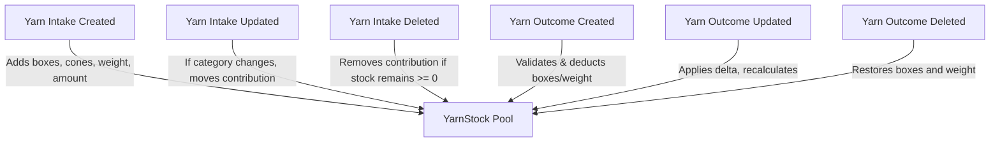

# Shared YarnStock Inventory API Specification & Frontend Integration Guide

> **Module:** Yarn Management & Shared Inventory  
> **Backend Framework:** Django REST Framework + SimpleJWT  
> **Base URL:** `/api/v1/`  
> **Status:** Production Ready  

---

## 1. Architecture Overview: Shared Stock Pools

### 1.1 The Shift from Intake Batches to Shared Stock Pools

| Previous Workflow | New Shared Stock Pool Workflow |
| :--- | :--- |
| Every `YarnIntake` acted as an isolated silo. | Intakes automatically merge into a shared **`YarnStock`** pool based on matching category fields. |
| `YarnOutcome` required selecting a specific `yarn_intake` batch ID. | `YarnOutcome` selects and deducts from a shared **`YarnStock`** pool (`stock_id` / `stockId`). No individual intake ID required. |
| Multiple deliveries of Cotton 20/1 Warp resulted in fragmented balances. | Multiple deliveries of Cotton 20/1 Warp accumulate into one unified pool balance. |
| Outcome dispatch was limited to whatever single intake had remaining. | Outcome dispatch draws from the cumulative stock pool of that yarn category. |

### 1.2 Stock Pool Identity (Uniqueness Definition)

A `YarnStock` pool is uniquely identified and distinguished by:
$$\text{Stock Pool} = (\text{yarn\_name}, \text{yarn\_type}, \text{yarn\_count}, \text{production\_type})$$

- **Example 1:**
  - Intake 1: Cotton, Carded, 20/1, Warp (100 kg)
  - Intake 2: Cotton, Carded, 20/1, Warp (150 kg)
  - **Shared Stock:** Cotton Carded 20/1 Warp $\rightarrow$ **250 kg received**
- **Example 2:**
  - Intake 3: Cotton, Carded, 30/1, Warp (80 kg)
  - **Separate Stock Pool:** Cotton Carded 30/1 Warp $\rightarrow$ **80 kg received**
- **Dispatch Example:**
  - If 40 kg is dispatched for Sizing from Cotton 20/1 Warp, available stock of Cotton 20/1 Warp becomes **210 kg**.
  - The Cotton 30/1 pool remains **80 kg** (completely untouched).

---

## 2. Field Definitions & Ledger Calculations

All weight conversions and financial rates use Python `Decimal` (never floating-point arithmetic).
$$\text{LB\_PER\_KG} = 2.20462262$$

### 2.1 Available Stock Fields in `YarnStock`

| Field (camelCase) | Field (snake_case) | Type | Meaning | Calculation Formula |
| :--- | :--- | :--- | :--- | :--- |
| `totalBoxes` | `total_boxes` | `integer` | Current available boxes/bags | $\sum \text{Intake Bags} - \sum \text{Outcome Bags}$ |
| `cones` | `cones` | `integer` | Current available cones | $\sum \text{Intake Cones} - \sum (\text{Outcome Bags} \times \text{Cones Per Bag})$ |
| `totalWeightKg` | `total_weight_kg` | `decimal(15,3)` | Current available weight in KG | $\sum \text{Intake Net KG} - \sum \text{Outcome Net KG}$ |
| `totalWeightLb` | `total_weight_lb` | `decimal(15,3)` | Current available weight in LB | $\text{totalWeightKg} \times 2.20462262$ |
| `price` | `price` | `decimal(15,2)` | Weighted average cost per bag (PKR) | $\frac{\sum \text{Intake Total Amount}}{\sum \text{Intake Bags}}$ |
| `pricePerKg` | `price_per_kg` | `decimal(15,2)` | Weighted average cost per KG (PKR) | $\frac{\sum \text{Intake Total Amount}}{\sum \text{Intake Net KG}}$ |

### 2.2 Historical Received & Dispatched Ledger Totals

| Field (camelCase) | Type | Description |
| :--- | :--- | :--- |
| `totalReceivedBoxes` | `integer` | Cumulative boxes received from all contributing intakes |
| `totalReceivedCones` | `integer` | Cumulative cones received from all contributing intakes |
| `totalReceivedWeightKg` | `decimal(15,3)` | Cumulative kilograms received |
| `totalReceivedWeightLb` | `decimal(15,3)` | Cumulative pounds received |
| `totalDispatchedBoxes` | `integer` | Cumulative boxes dispatched across all outcomes |
| `totalDispatchedWeightKg` | `decimal(15,3)` | Cumulative kilograms dispatched |
| `totalDispatchedWeightLb` | `decimal(15,3)` | Cumulative pounds dispatched |
| `intakesCount` | `integer` | Total number of delivery intake records in this pool |
| `outcomesCount` | `integer` | Total number of dispatches recorded against this pool |

---

## 3. Automatic Stock Recalculation Lifecycle

Every mutation triggers automatic database-level locking (`select_for_update`) and recalculation within an atomic transaction:



1. **On Intake Create:**
   - Finds or creates the matching `YarnStock` pool.
   - Recalculates available boxes, cones, weight, and weighted average price.
2. **On Intake Update:**
   - If stock attributes change (`yarnName`, `yarnType`, `yarnCount`, `productionType`), the intake's quantities are atomically transferred from the old pool to the new pool.
   - Both pools are recalculated.
   - **Protection:** If moving the intake would leave the old pool with negative available stock (due to prior dispatches), the update is rejected with `400 Bad Request`.
3. **On Intake Delete:**
   - **Protection:** If deleting the intake would leave remaining intakes less than dispatched outcomes, the deletion is rejected with `400 Bad Request`.
   - If valid, the intake is deleted and the stock pool is recalculated.
4. **On Outcome Create:**
   - The selected stock pool is locked with `select_for_update()`.
   - Validates that requested bags and weight do not exceed available stock.
   - Deducts quantities and recalculates pool balances.
5. **On Outcome Update:**
   - Excludes this outcome's previous quantities when calculating available stock.
   - If valid, saves changes and recalculates the stock pool.
6. **On Outcome Delete:**
   - Releases any active beam assignments back to `Available`.
   - Deletes outcome and immediately restores stock back to the pool.

---

## 4. API Endpoints Reference

### 4.1 Stock Pool Endpoints

| Method | Endpoint | Description | Permission |
| :--- | :--- | :--- | :--- |
| `GET` | `/api/v1/yarn-stocks/` | List/search/filter shared stock pools (Paginated) | `yarn_stock.view` or `yarn_intake.view` |
| `GET` | `/api/v1/yarn-stocks/:id/` | Retrieve detail of a single stock pool | `yarn_stock.view` or `yarn_intake.view` |
| `GET` | `/api/v1/yarn-stocks/:id/intakes/` | List all intakes contributing to this stock pool | `yarn_stock.view` or `yarn_intake.view` |
| `GET` | `/api/v1/yarn-stocks/:id/outcomes/` | List all outcomes deducted from this stock pool | `yarn_stock.view` or `yarn_outcome.view` |
| `POST` | `/api/v1/yarn-stocks/:id/reconcile/`| Force recalculate stock pool from source ledger | `yarn_stock.edit` |
| `POST` | `/api/v1/yarn-stocks/reconcile-all/`| Force recalculate all stock pools | `yarn_stock.edit` |

#### `GET /api/v1/yarn-stocks/` Query Parameters

| Parameter | Type | Example | Description |
| :--- | :--- | :--- | :--- |
| `search` | `string` | `?search=Cotton` | Search across name, type, count, production type |
| `yarn_name` | `string` | `?yarn_name=Cotton` | Case-insensitive filter on yarn name |
| `yarn_type` | `string` | `?yarn_type=Carded` | Case-insensitive filter on yarn type |
| `yarn_count` | `string` | `?yarn_count=20/1` | Exact/contains filter on yarn count |
| `production_type` | `string` | `?production_type=Warp` | Filter by Warp, Weft, etc. |
| `in_stock` | `boolean` | `?in_stock=true` | If `true`, returns only pools with `totalBoxes > 0` |
| `min_boxes` | `integer` | `?min_boxes=5` | Pools with at least X available boxes |
| `min_weight_kg` | `number` | `?min_weight_kg=100` | Pools with at least X available kilograms |
| `ordering` | `string` | `?ordering=-total_boxes` | Sort by `total_boxes`, `total_weight_kg`, `price`, `created_at` |
| `page`, `page_size` | `integer` | `?page=1&page_size=10` | Pagination control |

#### Sample Response (`GET /api/v1/yarn-stocks/`)
```json
{
  "success": true,
  "count": 1,
  "totalPages": 1,
  "currentPage": 1,
  "pageSize": 10,
  "results": [
    {
      "id": 1,
      "yarnName": "Cotton",
      "yarnType": "Carded",
      "yarnCount": "20/1",
      "productionType": "Warp",
      "price": "15600.00",
      "pricePerKg": "343.92",
      "totalBoxes": 21,
      "cones": 420,
      "totalWeightKg": "210.000",
      "totalWeightLb": "462.971",
      "totalReceivedBoxes": 25,
      "totalReceivedCones": 500,
      "totalReceivedWeightKg": "250.000",
      "totalReceivedWeightLb": "551.156",
      "totalDispatchedBoxes": 4,
      "totalDispatchedWeightKg": "40.000",
      "totalDispatchedWeightLb": "88.185",
      "intakesCount": 2,
      "outcomesCount": 1,
      "createdAt": "2026-10-12T10:00:00Z",
      "updatedAt": "2026-10-12T10:30:00Z",
      "createdBy": { "id": 1, "username": "admin" },
      "updatedBy": { "id": 1, "username": "admin" }
    }
  ]
}
```

---

### 4.2 Creating a Yarn Outcome (`POST /api/v1/yarn-outcomes/`)

Frontend selects a **`YarnStock`** pool (`stock` or `stockId`). A specific `yarn_intake` is **no longer required**.

#### Recommended Payload (Using `stock` or `stockId`):
```json
{
  "stock": 1,
  "outcomeType": "Sizing",
  "outcomeBags": 4,
  "outcomeConesPerBag": 20,
  "outcomeWeightPerBagKg": 10.000,
  "sizing": 3,
  "outcomeDate": "2026-10-12",
  "notes": "Dispatched for Set #101"
}
```
*(Dual-case: Accepts `stock` or `stockId`, `outcomeType`, `outcomeBags`, `outcomeConesPerBag`, `outcomeWeightPerBagKg`, `outcomeDate`)*

#### Backward-Compatibility Note:
If legacy frontend sends `"yarnIntake": 14` instead of `"stock"`, the backend automatically resolves `stock = yarn_intake.stock` without error.

#### Sample Outcome Response:
```json
{
  "success": true,
  "message": "Yarn outcome created successfully.",
  "data": {
    "id": 18,
    "stock": 1,
    "stockId": 1,
    "stockDetail": {
      "id": 1,
      "yarnName": "Cotton",
      "yarnType": "Carded",
      "yarnCount": "20/1",
      "productionType": "Warp",
      "price": "15600.00",
      "pricePerKg": "343.92",
      "totalBoxes": 21,
      "cones": 420,
      "totalWeightKg": "210.000",
      "totalWeightLb": "462.971"
    },
    "yarnIntake": null,
    "yarnIntakeId": null,
    "outcomeType": "Sizing",
    "outcomeBags": 4,
    "outcomeConesPerBag": 20,
    "outcomeWeightPerBagKg": "10.000",
    "outcomeWeightKg": "40.000",
    "outcomeWeightLb": "88.185",
    "yarnBuyer": null,
    "yarnBuyerDetail": null,
    "sizing": 3,
    "sizingDetail": {
      "id": 3,
      "sizingName": "Al-Rehman Sizing",
      "contactPerson": "Chaudhry Sab"
    },
    "totalPrice": "0.00",
    "ratePerKg": null,
    "status": "In Sizing",
    "sizingOutcome": null,
    "isReceived": false,
    "outcomeDate": "2026-10-12",
    "notes": "Dispatched for Set #101",
    "beamAssignments": [],
    "totalBeams": 0,
    "createdBy": { "id": 1, "username": "admin" },
    "updatedBy": { "id": 1, "username": "admin" },
    "createdAt": "2026-10-12T10:30:00Z",
    "updatedAt": "2026-10-12T10:30:00Z"
  }
}
```

---

## 5. Validation Errors & Error Handling

### 5.1 Stock Overdraw Error (`400 Bad Request`)
If requested bags or weight exceeds the current available balance in the selected stock pool:

```json
{
  "success": false,
  "message": "Validation failed.",
  "errors": {
    "outcomeBags": [
      "Requested outcome quantity (30 bags) exceeds available stock. Available: 21 bag(s)."
    ]
  }
}
```

### 5.2 Intake Deletion Protection (`400 Bad Request`)
If an operator attempts to delete an intake whose yarn was already dispatched:

```json
{
  "success": false,
  "message": "Validation failed.",
  "errors": {
    "detail": "Cannot delete yarn intake: dispatched outcomes (8 bags) would exceed remaining received intake stock (2 bags)."
  }
}
```

---

## 6. TypeScript Interfaces

```typescript
export interface YarnStockMin {
  id: number;
  yarnName: string;
  yarnType: string;
  yarnCount: string;
  productionType: string;
  price: string;
  pricePerKg: string;
  totalBoxes: number;
  cones: number;
  totalWeightKg: string;
  totalWeightLb: string;
}

export interface YarnStock extends YarnStockMin {
  totalReceivedBoxes: number;
  totalReceivedCones: number;
  totalReceivedWeightKg: string;
  totalReceivedWeightLb: string;
  totalDispatchedBoxes: number;
  totalDispatchedWeightKg: string;
  totalDispatchedWeightLb: string;
  intakesCount: number;
  outcomesCount: number;
  createdAt: string;
  updatedAt: string;
  createdBy?: { id: number; username: string } | null;
  updatedBy?: { id: number; username: string } | null;
}

export interface YarnOutcomeCreatePayload {
  stock: number; // YarnStock ID
  outcomeType: 'Sizing' | 'Weft' | 'Sold';
  outcomeBags: number;
  outcomeConesPerBag?: number;
  outcomeWeightPerBagKg: number | string;
  outcomeDate: string; // YYYY-MM-DD
  sizing?: number | null; // Required when outcomeType == 'Sizing'
  yarnBuyer?: number | null; // Required when outcomeType == 'Sold'
  totalPrice?: number | string; // Required when outcomeType == 'Sold'
  notes?: string;
  beamIds?: number[]; // Optional list of beam IDs for sizing assignment
}
```

---

## 7. Frontend Integration Checklist

1. **Inventory Stock Page:**
   - Call `GET /api/v1/yarn-stocks/?in_stock=true` to display available yarn inventory table.
   - Display columns: Yarn Name, Type, Count, Production Type, Available Boxes, Available Weight (kg / lb), Cones, and Weighted Avg Price (PKR/bag).
   - Add search input connected to `?search=`.
2. **Outcome Dispatch Form:**
   - Replace the old "Select Yarn Intake" dropdown with a **"Select Yarn Stock Pool"** dropdown querying `/api/v1/yarn-stocks/?in_stock=true`.
   - When a stock pool is selected, show an info badge: `Available: X boxes (Y kg)`.
   - Validate that `outcomeBags <= stock.totalBoxes`.
   - Submit `stock: stock.id` in the POST request body.
3. **Stock Detail Modal / Screen:**
   - Tabs:
     - **Contributing Deliveries:** Fetch `/api/v1/yarn-stocks/:id/intakes/` to show all intake shipments in this pool.
     - **Dispatched Outcomes:** Fetch `/api/v1/yarn-stocks/:id/outcomes/` to show dispatch history.
